

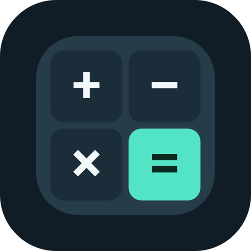

# Calculator

### Beautifully simple. Powerfully precise.

**Every number has a better way.**

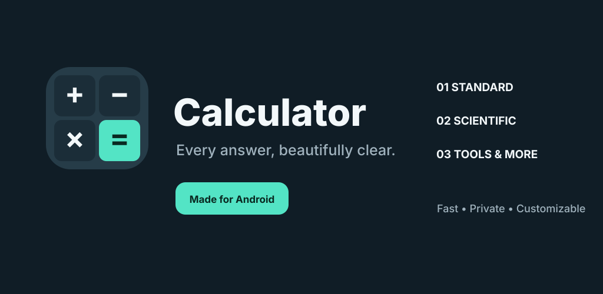

A more thoughtful way to calculate, convert and explore. Designed around the moments that matter, from everyday arithmetic to advanced mathematics.

---

## The calculator that does more

| ✦ Everyday clarity | ∑ Powerful mathematics | ◈ Made for you |
|:--|:--|:--|
| Effortless everyday calculations with a spacious, easy-to-read keypad. | Scientific functions, programmer number systems and graphing tools. | Elegant themes, accessible controls and settings that suit your style. |

## Explore Calculator

<table>
<tr>
<td width="33%" align="center">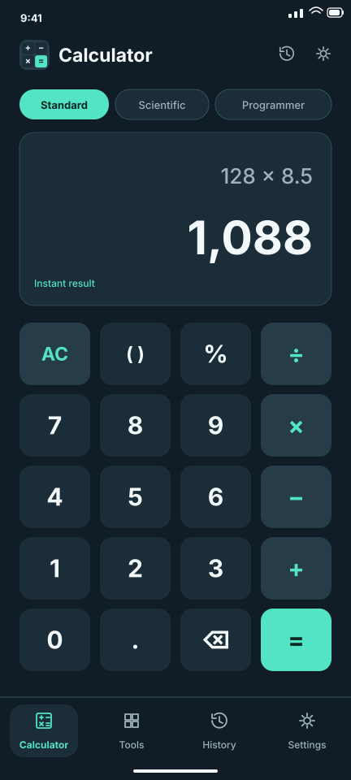<b>Everyday essentials</b></td>
<td width="33%" align="center">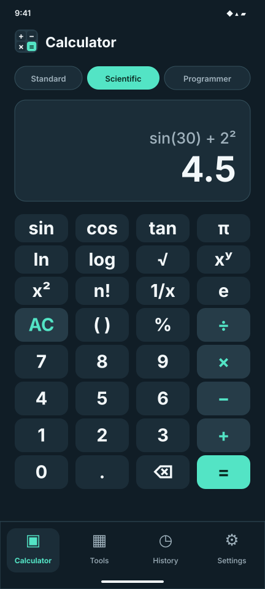<b>Advanced precision</b></td>
<td width="33%" align="center">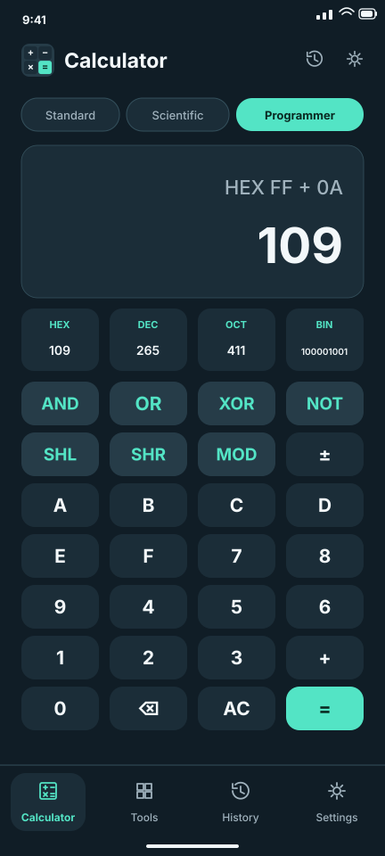<b>Built for every base</b></td>
</tr>
<tr>
<td align="center">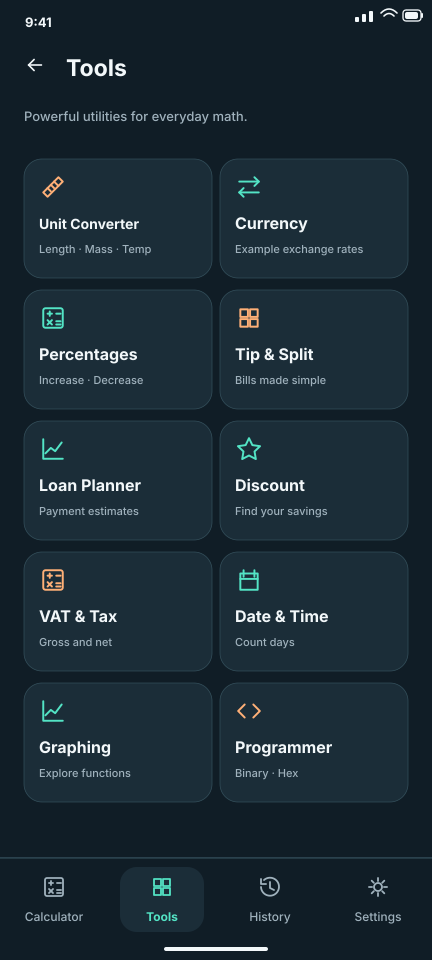<b>All your tools</b></td>
<td align="center">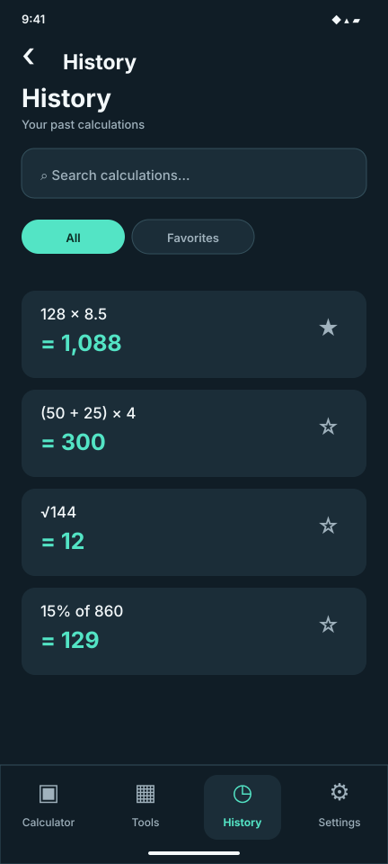<b>Every answer, saved</b></td>
<td align="center">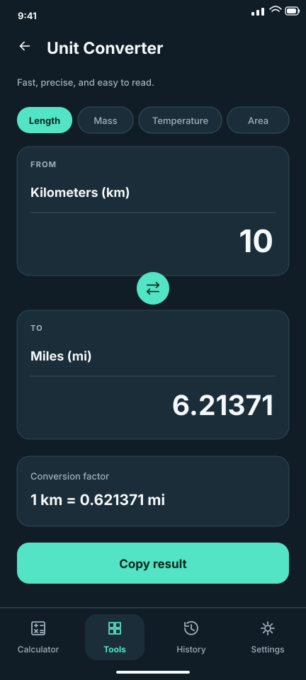<b>Convert with confidence</b></td>
</tr>
</table>

*Visual previews of the Calculator design.*

## Thoughtful tools

**Calculate** — Standard, Scientific and Programmer modes.

**Convert** — Length, weight, temperature, area, volume, speed, time and digital units. Currency calculations support exchange rates that you enter yourself.

**Plan** — Percentages, discounts, taxes, tips, shared bills and monthly loan estimates.

**Explore** — Function graphing, useful date calculations, searchable history and saved favorites.

**Personalize** — Dark, Light and AMOLED themes, angle preferences, digit grouping and tactile feedback.

## Made to feel effortless

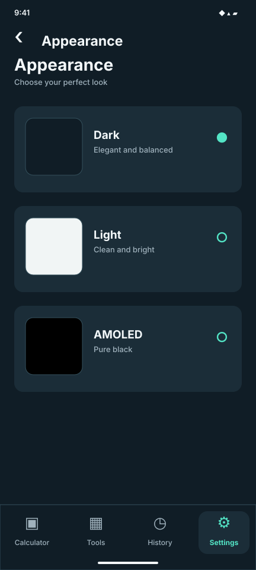
&nbsp;
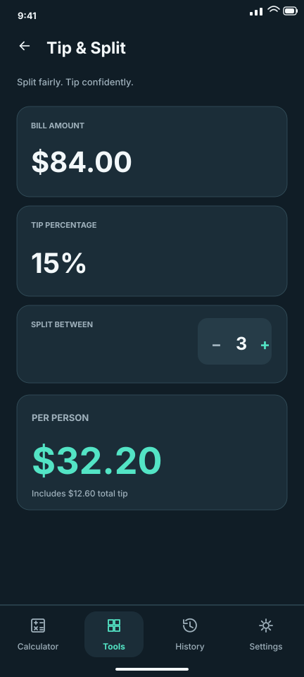
&nbsp;
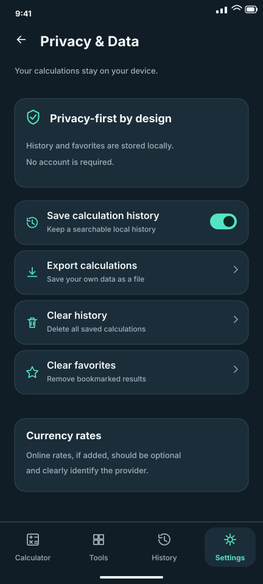

No accounts. No advertising SDK. No tracking. Your history and preferences stay on your device. With a quick-launch widget and useful home screen shortcuts, the right calculator is only a tap away.

**Calculator** puts mathematics first — a beautiful interface, useful tools and the freedom to make it yours.

---

### Simply calculate.

© 2026 Calculator · [MIT License](LICENSE)

